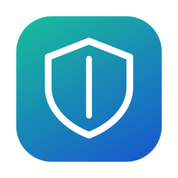

<p align="center"></p>
<h1 align="center">Dozor · Дозор</h1>
<p align="center">Контроль выходного IP для macOS</p>
<p align="center"><a href="https://github.com/Albiz19/Dozor/releases/latest">Скачать выпуск</a> · <a href="docs/GUIDE.md">Инструкция</a> · <a href="README.en.md">English</a> · <a href="LICENSE">MIT</a></p>

Когда вы работаете с зарубежным сервисом через VPN, переподключение может сменить публичный IP посреди сессии. Dozor позволяет заранее указать доверенные адреса и выбрать приложения, работу которых нужно приостановить при смене выхода. Это снижает риск, что незаметная смена IP вызовет проверку аккаунта. Решение о проверке или блокировке принимает сам сервис, и гарантировать отсутствие бана невозможно.

## Что умеет Dozor

| Возможность | Когда пригодится |
|---|---|
| Выбор приложений и их дочерних процессов | Можно защищать рабочий клиент и запущенные им утилиты, продолжая пользоваться остальным Mac. |
| Проверка IPv4, IPv6 и маршрута через прокси | Dozor сверяет внешний IP у нескольких источников и учитывает разрешённые адреса и подсети. В строке меню виден текущий выход. |
| Удержание заморозки | Перезапуск Dozor и возврат локального прокси сами по себе не размораживают уже остановленные процессы. Для этого нужны свежие проверки и подтверждение выбранной системной службы VPN или активного туннеля incy. |
| Защищённый запуск Claude Code | Локальный профиль macOS ограничивает прямые сокеты CLI и его потомков TCP-соединением к заданному порту локального прокси с самого запуска. |
| Telegram и локальный журнал | Бот сообщает о заморозке и возобновлении. Журнал, история смены IP и графики задержки помогают разобраться, что происходило со связью. |

## Начало работы

Требуется **Mac с Apple Silicon и macOS 13 или новее**. Интерфейс версии 0.2 на русском языке. Для первого знакомства можно запустить монитор и посмотреть IP до включения защиты.

**Homebrew**

```sh
brew tap albiz19/dozor https://github.com/Albiz19/Dozor.git
brew trust --cask albiz19/dozor/dozor
brew install --cask albiz19/dozor/dozor
open -a Dozor
```

**Сборка из исходников**

```sh
git clone https://github.com/Albiz19/Dozor.git
cd Dozor
./build.sh
open Dozor.app
```

Понадобятся инструменты разработчика Apple (`xcode-select --install`). В [GitHub Releases](https://github.com/Albiz19/Dozor/releases/latest) также лежат ZIP приложения и SHA-256. Публичная сборка имеет локальную подпись ad hoc. Gatekeeper может ограничить первый запуск скачанного приложения. Сборка из исходников доступна без сертификата разработчика.

**Настройка защиты**

1. Подключите рабочий VPN и получите его доверенный выходной IP у своего провайдера или администратора. Добавьте его в «Блокировка → Разрешённые IP».
2. Выберите приложения, укажите порт их локального HTTP-прокси и, если он есть, ID системной службы VPN из `scutil --nc list`.
3. Включите автоматическую блокировку. Кнопка «Приостановить блокировку» показывает, что блокировка работает. Проверьте причину решения в этом же окне. Пустой список разрешённых IP удерживает выбранные процессы в заморозке. Для incy в режиме TUN оставьте ID службы пустым. Обычного прокси без подтверждённого туннеля для разморозки недостаточно.

**Обновления** доступны в «Настройки → Обновления → Проверить обновления». При появлении новой стабильной версии приложение предложит открыть её выпуск. Для копии, установленной через Homebrew, выполните `brew update`, затем `brew upgrade --cask albiz19/dozor/dozor`. Перед заменой запланируйте перезапуск Dozor. Настройки хранятся отдельно от приложения.

## Какую защиту даёт каждый режим

| Режим | Что проверено |
|---|---|
| Обычный запуск выбранного приложения | Dozor останавливает обнаруженные процессы после изменения сети. Между изменением маршрута и обнаружением возможен трафик. Данные, уже переданные ядру, могут уйти. |
| Запуск через `dozor-run` | В локальном испытании родитель, ребёнок и внук работали через тестовый прокси. При 36 прямых попытках TCP/UDP по IPv4/IPv6 контрольные приёмники не получили данных. Выход самого прокси зависит от его настроек. |
| Системное расширение Network Extension | Исходники и собираемый провайдер входят в проект. В 0.2 проверена логика решений. Для активации в macOS нужны подпись Developer ID, профили и разрешение пользователя. В публичном ZIP фильтр не активируется. |

[Настроить Telegram, запустить Claude Code или посмотреть особенности VPN →](docs/GUIDE.md)

## Разработка

```sh
python3 tests/run.py
```

Тесты используют временные процессы, loopback и имитацию Telegram Bot API. macOS CI собирает приложение и выполняет этот же набор проверок. Об изменениях для пользователей см. [список выпусков](CHANGELOG.md). Для участия см. [CONTRIBUTING.md](CONTRIBUTING.md).
